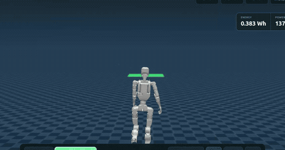
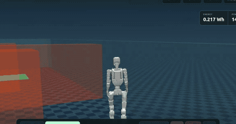
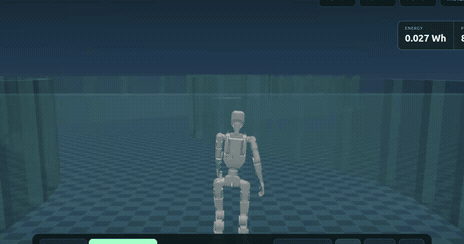

# ecowalk-drive!! — K1 EcoWalk Game

v5.6.3のK1 MP EcoWalkをCPU MuJoCoでテレオペし、ゴールまでの推定消費エネルギーを競うゲーム。Ubuntu 24.04 / Python 3.12を推奨。GPU不要（描画にはMesa/OpenGLが必要）。Gazeboへの移植は含みません。

既存の `k1-mp-ecowalk-public` と `k1-mp-ecowalk-teleop` は別の依存チェックアウトとして読み込むだけです。本リポジトリから変更しません。対象コミットは `backend.py` と `scripts/setup.sh` に固定しています。

## 開発体制・AIの利用

本ゲームは、プロジェクト作成者（Takeyuki-K）が発案・仕様・評価方針を策定し、OpenAIのChatGPTとの設計検討、およびCodexによる実装支援を受けて開発しました。AIを利用して制作したことは、動作や検証結果を保証するものではありません。実装の検証範囲は「検証」節をご確認ください。

## プレイ動画 — Stage 1〜3

各ステージのプレイ動画を短いGIFで紹介します。

### Stage 1 — 直線コース



### Stage 2 — 障害物回避



### Stage 3 — S字通路



## 起動

```bash
git clone https://github.com/Takeyuki-K/k1-mp-ecowalk-game.git
cd k1-mp-ecowalk-game
sudo apt install python3-venv libgl1-mesa-dri libegl1 libosmesa6
bash scripts/setup.sh
source .venv/bin/activate
MUJOCO_GL=egl k1-game --render-fps 30
```

ブラウザで http://localhost:8090 を開きます。タイトルメニューからステージ1・2・3・4を選択。プレイ画面はブラウザの表示領域いっぱいに配置し、全画面ボタン（またはF11）も利用できます。ランキング・操作説明は上部ボタンから開きます。依存のEcoWalk・teleopリポジトリも公開されており、通常のcloneにGitHub認証は不要です。Mesa EGLが使えない環境では `MUJOCO_GL=osmesa` を使用してください。CPUが遅い場合は実時間より遅くなりますが、採点はシミュレーション時間です。torchはCPU版をインストールします。ROS 2なしでも遊べます。

### 操作方式

- **キー操作**：W/↑を押し続けて前進、A/Dまたは←/→で旋回。離すと停止。Shift＋前進で4.0m/s。速度±ボタンまたは「ゆっくり」「歩行」「走行」で通常速度を変更。Space停止、B急停止、C視点切替。一人称では映像を左ドラッグして見回すか、J/L（左右、前の操作から反転）は離すとYawが滑らかに0°へ戻り、I/K（上下）は押している間滑らかに動き、R（正面リセット）。頭部前面（head_link原点から正面12cm、上3cm）を仮想カメラ位置とします。実際の外装との干渉はMuJoCo画面で確認してください。yawは±90°、pitchは上45°・下65°。カメラ操作は物理・採点とは独立。三人称はロボットの真後ろから全身を表示し、位置・向きへの追従を平滑化して歩行の揺れを抑えます。旋回時には少し遅れて追従します。
- **画面ジョイスティック**：操作方式を切り替え、パッドをドラッグ。上が前進、左右が旋回。離すと停止。teleopパッケージと同様、縦軸を非線形（gamma=1.7）にして歩行速度を選びやすくしています。
- **USBゲームパッド**：ジョイスティックモードで「USBゲームパッドを使う」を有効化。標準マッピングの左スティック、A停止、B急停止。接続後に一度スティックを中央へ戻してから操作。非標準マッピングは画面パッドを使用してください。
- ダイアログ表示・操作方式切替・フォーカス喪失時は停止指令。通信が0.5秒途絶えると停止。後退・横移動はありません。

### 描画の滑らかさ

MuJoCoの計算も描画も自分のPCで実行し、localhost経由でブラウザへ表示。従来の画像ポーリング（ブラウザ約4fps）をMJPEG連続配信へ変更。標準画質は1280×720・JPEG品質90。標準30fps、最大60fpsまで設定可能です。描画とJPEG処理は専用スレッドで行い、物理計算のロックを占有しません。配信は最新フレームを優先し、古い画像をためません。

```bash
MUJOCO_GL=egl k1-game --render-fps 30
# Mesa EGLで映らない環境
MUJOCO_GL=osmesa k1-game --render-fps 30
```

影と反射を省いて描画負荷を軽減。AMDなどの内蔵GPUを使えるUbuntuデスクトップでは `unset LIBGL_ALWAYS_SOFTWARE` として、ソフトウェア描画を強制しないでください。EGLが使えない場合は `MUJOCO_GL=glfw`（デスクトップ環境が必要）も試せます。OSMesaはCPUソフトウェア描画のフォールバックです。

画面下に実測fpsとシミュレーションの実時間比を表示。数値はPC性能に依存し、60fpsを保証しません。物理・方策は50Hzです。消費電力を測るゲームなので、描画設定を変えても採点に用いる時間・積算方式は変えません。

ゴール範囲内では「停止判定まち…」と判定進捗を重ねて表示。完走すると「ゴール！！」、スコア、消費Wh・平均W・時間・衝突回数・8時間予測を表示し、シミュレーションを停止します。再挑戦・ステージ選択・ランキング送信ができます。

## 結果画面のランク表示

完走時のゲーム標準スコアに応じて、結果画面にランクを表示します。Stage 1・2は2000点以上：SS、1800点以上：S、1500点以上：A、1000点以上：B、それ未満：C。Stage 3は1700点以上：SS、1500点以上：S、1200点以上：A、900点以上：B、それ未満：C。Stage 4はStage 1・2と同じ基準です。**完走時に衝突が1回以上あれば回数にかかわらず1ランクダウン**（SS→S→A→B→C→D）します。転倒、接触停止、コースアウト、時間切れ、中断など未完走はDです。ランクは結果画面だけの表示であり、既存の点数・ランキング登録・物理・記録・省エネ計算は変更しません。

## ステージと採点

- Stage 1：開始位置から20m、障害物なし。
- Stage 2：開始位置から10m。左右の壁へ交互につながる半透明のオレンジの箱3個を避けます。各障害物の横に2mの通路を確保。幅5mの通路を高さ1.6mの壁で囲み、両端も閉じて外側からの迂回を防ぎます。
- Stage 3：ゴールは開始位置からX方向28m。幅に余裕のあるS字通路（左右の壁のY方向間隔5m、曲がり部分の実効幅は約3.5m以上）。コース形状・壁・ゴールの位置と寸法は `rules.py`。
- Stage 4（TIMING & SPEED）：ゴールは開始位置からX方向34m。幅5mの直線通路に、独立して開閉する3組の壁があります。タイミングと速度を合わせて通過します。動く壁はミニマップに表示されないため、カメラ映像で確認してください。壁はシミュレーション時刻で動き、停止中も動作します。壁に挟まれて深くめり込むと「接触により停止」（`collision`）として失敗になります。軌道は `obstacles.py` に分離し、プレイヤー向けAPIには出力しません。
- プレイ画面に全体のミニマップを表示。壁・障害物・ゴール・現在位置と向きを確認できます。黄色の矢印が現在位置、緑がゴールです。ゴールまでの表示は直線距離です。
- ゴール中心±0.75m（前後）・±1m（左右）内で、立位モード、水平速度<0.08m/s、角速度<0.08rad/sを1秒維持して完走。
- 転倒、範囲外、300秒経過、Stage 4の接触停止は失敗（0点）。再挑戦は新しい記録。各ステージは個別採点。
- スコア = max(0, 10000 / (1 + E[J]/1000) − 250 × 衝突回数)。同じ衝突回数なら総消費エネルギーが小さいほど高得点。平均Wは別表示。
- 衝突は物理ステップで取得し、20ms区間に一度でも接触した障害物・壁を集約。同一障害物への連続接触は1回、0.3秒を超えて離れて再接触すると再減点。床接触は減点しません。頭・腕は上流モデルの設定どおり非衝突です（Stage 4の動く壁に限り、頭・腕・外観メッシュも接触対象）。

## 電力と8時間予測

物理ステップごとの実際の制御入力・関節状態から、23モーター合計 `P = Σ(τ²/Km² + max(τ q̇, 0))` を積算。Kmは上流比較コードと同じ仮定（4.0、足首roll/腕は2.2）。回生なし。脚だけの上流 `/k1/status` 電力値とは一致しません。モデル推定であり実機電力ではありません。

総消費：Wh = J/3600。平均電力：W = J/秒。8時間のエネルギー：Wh = 平均W × 8。補機電力を設定すれば加算。バッテリーを満充電で開始し、交換回数 = max(0, ceil(8時間Wh / 有効容量Wh) − 1)。同じステージを連続反復、休憩やバッテリー交換の時間を除く単純予測です。

```bash
# 任意のバッテリー容量に変更（標準は400Wh、有効容量率80%）
MUJOCO_GL=egl k1-game --render-fps 30 --battery-wh 600 --usable-fraction 0.8 --auxiliary-w 20
```

`--observation-only` を付けると一人称映像と通常の操作だけに制限し、保存記録・再生・ランキング・送信のAPIをサーバー側で拒否します（`--replay` とは併用不可）。

バッテリー容量は標準400Wh（ゲームの計算用設定であり、実機K1の容量を示すものではありません）。`--battery-wh` で任意の正の容量に変更できます。標準の有効容量率80%では320Whとして交換回数を計算します。容量設定は消費エネルギーのスコアには影響せず、8時間予測の交換回数に使用します。

## 記録と再生

ステージ開始時から `runs/<UUID>/` にmetadata、50Hzの状態・指令・電力・接触・採点JSONL、結果JSONを自動保存。物理は5ms、状態再生は20ms。再生は保存済み状態を直接戻すので、指令の再積分による軌道のずれを避けます。同じコミット・MuJoCo版で使ってください。画面上で一時停止・シーク・0.5倍／1倍／2倍の速度切替ができます。記録に含まれるコース形状を復元して再生します。

```bash
k1-game --replay runs/<UUID>
```

ROS 2 Jazzy環境では実際のrosbag2も記録できます。ROSをsourceし、`rosbag2_py`, `rclpy`, `std_msgs`をPythonからimportできる必要があります（venvは `python3 -m venv --system-site-packages .venv` で作成）。ゲームが開始した時点でwriterを開き、終了時に閉じます。ROS依存がなければ明示的に失敗します。

```bash
source /opt/ros/jazzy/setup.bash
k1-game --rosbag
ros2 bag info runs/<UUID>/rosbag
k1-game --replay runs/<UUID>/rosbag --stage 1
```

bagトピック `/k1_game/frame`（std_msgs/String）に完全なMuJoCo状態・指令・電力・接触・スコアを格納。`ros2 bag play`はこのトピックを再配信できます。見た目の再生は上の `--replay`。既存teleopの `/joint_states` や `/odom` をこのゲームが配信する構成ではありません。

## 保存記録・ランキング・アップロード・再生

通常起動だけで、PC内ランキングを使えます。DBは `runs/ranking.db`、登録した再生データは `runs/ranking-uploads/` に保存します。`--output` を指定すれば保存先全体を変更できます。再起動後も保存先が同じなら記録とランキングが残ります。

1. プレイ終了時、結果と状態記録は自動保存されます。完走画面で名前を入力し「ランキングに登録」を押してください。「再生データも共有」は初期状態でONです。
2. タイトル上部の「保存記録」から、完走・失敗の記録を再生できます。過去の完走もここからランキングに登録できます。
3. 「ファイル保存」で結果・コース・再生状態を含むJSONファイルをダウンロードします。他のPCへ移す場合は「記録ファイルを読み込んで再生」を使ってください。読み込んだ記録もPC内に保存されます。
4. ランキングの「▶ 再生」で登録されたプレイを視聴できます。再生データを共有しなかった行は「記録なし」になります。
5. 再生中は一時停止、先頭へ戻る、シーク、0.5／1／2倍、視点切替に対応。終了するとステージ選択へ戻ります。再生中は運転操作・再採点しません。

### 複数PCで共通ランキングを使う場合

ゲーム起動時に `--ranking-url` を指定すると、登録先とランキング表示が共有サーバーへ切り替わります。結果のアップロードは登録ボタンを押したときだけ行います。サーバーはSQLiteに結果、ファイルに再生データを永続保存。認証付き `GET /replays/<run_id>` からデータを取得してローカルMuJoCoで再生します。スコアはサーバーがエネルギーと衝突回数から再計算します。

```bash
export K1_RANKING_TOKEN='<24文字以上の共有シークレット>'
# 共有サーバー側
k1-ranking --host 127.0.0.1 --port 8091
# 各ゲーム側（同じtokenを環境変数に設定）
k1-game --ranking-url http://localhost:8091
# CLIから過去の完走を登録する場合
python scripts/submit.py runs/<UUID> --url http://localhost:8091 --player 'player1' --include-replay
```

外部の人が使う場合は自分のサーバー上でHTTPSリバースプロキシの背後に配置してください。サーバーコードは同梱していますがインターネット上への公開はしていません。ゲーム操作APIはローカルだけにbind。共有tokenはソースに保存しません。1送信32MiBまでです。物理検証や不正対策はなく、信頼できる招待者の自己申告ランキングです。

再生には同じv5.6.3モデルの状態サイズが必要です。コース情報を含む旧ルールの記録は当時の形状で再生できますが、変更後のランキングには登録できません。旧コース情報を含まないJSON記録は画面での再生対象外です。既存のrosbag CLI再生も引き続き利用できます。

## 検証

```bash
python -m pytest tests -q
node tests/test_controls.cjs  # Nodeがある場合：入力マッピング検証
```

採点・単位・停止判定・接触回数・不正な数値を検証。CPU上の実ポリシー検証結果は `docs/smoke-results.json` と `docs/VALIDATION.md`、Stage 4は `docs/VALIDATION_VNEXT.md`。ROS 2 bag実行とユーザーのPC上の実時間性能は別途確認が必要です。

## ライセンス

利用・参照したリポジトリとライセンスの一覧は [THIRD_PARTY_LICENSES.md](THIRD_PARTY_LICENSES.md) を参照してください。

本ゲームコード：Apache-2.0。発案・仕様：Takeyuki-K、実装：OpenAI Codex。依存のコード・モデル・参照軌道は各リポジトリのLICENSE/NOTICE/THIRD_PARTY_LICENSESに従います。モデルや動作データは本リポジトリへ再配布しません。ROBOTIS公認ではなくシミュレーション専用です。

### コース更新時のランキング

新コースはルール識別子 `ecowalk-game-3` で採点します。ランキングサーバーも更新・再起動してください。既存DBは起動時に自動移行し、旧ルールの記録は保持したまま新ランキングには混ぜません。ステージ3のランキングにも対応しています。
